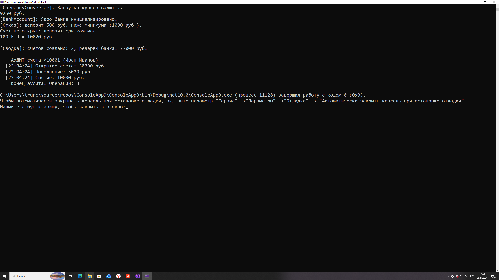

# Практическая Работа 14. Структуры. Трунцев Богдан, П25-2.1


## 1. GeoCoordinate.cs
```csharp
public readonly struct GeoCoordinate
{
    public double Latitude { get; }
    public double Longitude { get; }

    public GeoCoordinate(double latitude, double longitude)
    {
        // Валидация с «прижиманием» к границе диапазона.
        Latitude = Math.Clamp(latitude, -90.0, 90.0);
        Longitude = Math.Clamp(longitude, -180.0, 180.0);
    }

    // Приближённое декартово расстояние в километрах.
    public double DistanceTo(GeoCoordinate other)
    {
        return Math.Sqrt(Math.Pow(Latitude - other.Latitude, 2)
                       + Math.Pow(Longitude - other.Longitude, 2)) * 111.0;
    }

    public override string ToString() => $"({Latitude:F4}°, {Longitude:F4}°)";
}
```

### 2. Vector3D.cs
```csharp
// Шаг 2. Изменяемая структура: без readonly, поля можно менять после создания.
public struct Vector3D
{
    public double X;
    public double Y;
    public double Z;

    public Vector3D(double x, double y, double z)
    {
        X = x;
        Y = y;
        Z = z;
    }

    // Вычисляемое свойство: не хранится в памяти, считается на лету.
    public double Length => Math.Sqrt(X * X + Y * Y + Z * Z);

    // Методы мутируют ТЕКУЩУЮ копию структуры (this).
    public void Add(Vector3D other)
    {
        X += other.X;
        Y += other.Y;
        Z += other.Z;
    }

    public void Scale(double factor)
    {
        X *= factor;
        Y *= factor;
        Z *= factor;
    }

    public override string ToString() => $"[X: {X:F1}, Y: {Y:F1}, Z: {Z:F1}]";
}
```

### 3. DroneState.cs
```csharp
// Шаг 3. Составная структура: внутри — другие структуры и простой тип.
public struct DroneState
{
    // Неизменяемый номер борта: только get, задаётся в конструкторе.
    public int DroneId { get; }

    // Вложенные структуры — хранятся «внутри» DroneState, без ссылок в кучу.
    public GeoCoordinate Position { get; set; }
    public Vector3D Velocity { get; set; }

    public int BatteryPercent { get; set; }

    // Вычисляемый статус: дрон «на земле», если координаты нулевые.
    public bool IsGrounded => Position.Latitude == 0 && Position.Longitude == 0;

    public DroneState(int droneId, GeoCoordinate position, Vector3D velocity, int batteryPercent)
    {
        DroneId = droneId;      // readonly-свойство можно присвоить только в конструкторе
        Position = position;
        Velocity = velocity;
        BatteryPercent = batteryPercent;
    }

    public override string ToString() =>
        $"Дрон #{DroneId}: поз. {Position}, скорость {Velocity}, заряд {BatteryPercent}%";
}
```

### 4. TelemetryProcessor.cs
```csharp
// Шаг 4. Статический класс расчётов.
public static class TelemetryProcessor
{
    // ОШИБОЧНЫЙ вариант (специально, для демонстрации):
    // drone приходит КОПИЕЙ. Все изменения затрагивают копию и исчезают на выходе.
    public static void ApplyDrift(DroneState drone, Vector3D wind)
    {
        drone.Velocity.Add(wind); // меняем копию — вызывающий код этого не увидит
    }

    // ПРАВИЛЬНЫЙ вариант: ref — метод работает с исходной структурой в стеке.
    public static void ApplyDriftCorrect(ref DroneState drone, Vector3D wind)
    {
        // Подводный камень: drone.Velocity — свойство, геттер возвращает КОПИЮ вектора.
        // Вызов drone.Velocity.Add(wind) изменил бы эту копию и потерял эффект.
        // Поэтому: достали копию -> изменили -> записали обратно через сеттер.
        Vector3D v = drone.Velocity;
        v.Add(wind);
        drone.Velocity = v;
    }

    // Один шаг симуляции полёта.
    public static void SimulateFlightStep(ref DroneState drone, double timeSeconds)
    {
        // Расход батареи: 1% за каждые 5 секунд полёта.
        int drain = (int)(timeSeconds / 5.0);
        drone.BatteryPercent -= drain;

        // Смещение координат пропорционально проекциям скорости.
        // (деление на 111000 переводит метры в градусы)
        double newLatitude = drone.Position.Latitude
                           + drone.Velocity.Y * timeSeconds / 111000.0;
        double newLongitude = drone.Position.Longitude
                            + drone.Velocity.X * timeSeconds / 111000.0;

        // Собираем новый GeoCoordinate (структура неизменяемая — не «правим», а заменяем)
        // и записываем обратно в поле дрона.
        drone.Position = new GeoCoordinate(newLatitude, newLongitude);
    }
}
```

### 5. TelemetryProcessor.cs
```csharp
using System;

class Program
{
    static void Main()
    {
        Console.WriteLine("=== Эксперимент 1: независимость копий ===");

        Vector3D v1 = new Vector3D(10, 20, 30);
        Vector3D v2 = v1;          // ПОЛНАЯ побитовая копия, а не ссылка
        v2.X = 999;                // меняем только копию

        Console.WriteLine($"v1: {v1}"); // X остался 10 — v1 не тронут
        Console.WriteLine($"v2: {v2}"); // X = 999 — изменилась только копия
        // Для сравнения: будь v1 классом, v2.X = 999 изменило бы ОБА объекта,
        // потому что обе переменные указывали бы на один объект в куче.

        Console.WriteLine("\n=== Эксперимент 2: передача по значению vs ref ===");

        DroneState drone = new DroneState(
            101,
            new GeoCoordinate(55.7558, 37.6173),
            new Vector3D(15, 0, 5),
            100);

        Console.WriteLine($"До:    {drone}");

        TelemetryProcessor.ApplyDrift(drone, new Vector3D(5, 5, 0));
        Console.WriteLine($"После ApplyDrift:        {drone}"); // скорость НЕ изменилась

        TelemetryProcessor.ApplyDriftCorrect(ref drone, new Vector3D(5, 5, 0));
        Console.WriteLine($"После ApplyDriftCorrect: {drone}"); // скорость выросла до [X: 20.0, ...]

        Console.WriteLine("\n=== Эксперимент 3: массив структур ===");

        DroneState[] swarm = new DroneState[3];
        swarm[0] = new DroneState(201, new GeoCoordinate(55.0, 37.0),
                                  new Vector3D(10, 20, 0), 100);
        swarm[1] = new DroneState(202, new GeoCoordinate(59.93, 30.33),
                                  new Vector3D(-15, 5, 0), 80);
        swarm[2] = new DroneState(203, new GeoCoordinate(48.85, 2.35),
                                  new Vector3D(0, -12, 0), 45);

        // ref swarm[i] ОБЯЗАТЕЛЕН: без ref метод получил бы копию элемента
        // массива, и все расчёты пропали бы впустую.
        for (int step = 1; step <= 3; step++)
        {
            for (int i = 0; i < swarm.Length; i++)
            {
                TelemetryProcessor.SimulateFlightStep(ref swarm[i], 10.0);
            }
        }

        foreach (DroneState d in swarm)
        {
            Console.WriteLine(d); // итоговая телеметрия после 3 шагов
        }

        Console.WriteLine("\n=== Эксперимент 4: Boxing / Unboxing ===");

        object boxedDrone = drone; // Boxing: структура копируется в кучу

        // Так сделать НЕЛЬЗЯ ожидать эффекта:
        // ((DroneState)boxedDrone).BatteryPercent = 50;
        // Распаковка создаёт ВРЕМЕННУЮ копию, присваивание меняет копию,
        // которая сразу выбрасывается — boxedDrone в куче остаётся прежним.

        // Правильная распаковка с перезаписью:
        DroneState unboxed = (DroneState)boxedDrone; // Unboxing: копия из кучи
        unboxed.BatteryPercent = 50;                 // меняем копию — она живая переменная
        boxedDrone = unboxed;                        // упакуем обновлённое значение заново

        Console.WriteLine($"drone после распаковки:      {drone}");        // заряд 94% (не тронут)
        Console.WriteLine($"boxedDrone после перезаписи: {boxedDrone}");   // заряд 50%
    }
}
```


