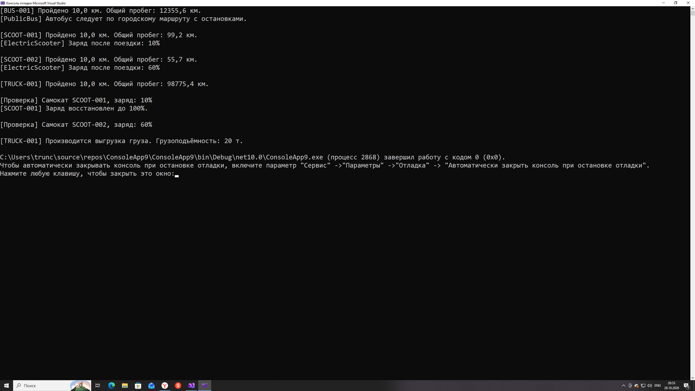

# Практическая Работа 12. Полиморфизм. Трунцев Богдан, П25-2.1


```csharp
using System;

public abstract class NotificationChannel
{
    protected string ChannelName;
    public int DeliveredCount { get; protected set; }
    public abstract bool IsOnline { get; }

    protected NotificationChannel(string name)
    {
        ChannelName = name;
    }

    public abstract bool Deliver(string recipient, string message);

    public virtual string FormatPayload(string rawMessage)
        => \$"[{ChannelName}] {rawMessage}";

    public void PrintAudit()
        => Console.WriteLine(\$"Канал: {ChannelName} | Доставлено: {DeliveredCount}");
}

public class EmailChannel : NotificationChannel
{
    public override bool IsOnline => true;

    public EmailChannel(string name) : base(name) { }

    public override string FormatPayload(string rawMessage)
        => base.FormatPayload(rawMessage) + "\n---\nС уважением, Почтовый Сервис";

    public override bool Deliver(string recipient, string message)
    {
        if (!recipient.Contains("@")) return false;
        DeliveredCount++;
        Console.WriteLine(\$"[{ChannelName}] Email: {FormatPayload(message)}");
        return true;
    }
}

public class TelegramChannel : NotificationChannel
{
    public override bool IsOnline => true;

    public TelegramChannel(string name) : base(name) { }

    public override bool Deliver(string recipient, string message)
    {
        if (!recipient.StartsWith("@") || message.Length > 100) return false;
        DeliveredCount++;
        Console.WriteLine(\$"[{ChannelName}] Telegram: {FormatPayload(message)}");
        return true;
    }
}

public class SirenAlarmChannel : NotificationChannel
{
    public override bool IsOnline => true;

    public SirenAlarmChannel() : base("Звуковая Сирена") { }

    public new string FormatPayload(string rawMessage)
        => "[ТРЕВОГА МЧС]: " + rawMessage.ToUpper();

    public override bool Deliver(string recipient, string message)
    {
        Console.WriteLine("[Звуковая Сирена] ТРЕВОГА!");
        DeliveredCount++;
        return true;
    }
}

class Program
{
    static void Main()
    {
        var channels = new NotificationChannel
        {
            new EmailChannel("SMTP"),
            new TelegramChannel("Telegram"),
            new SirenAlarmChannel()
        };

        string msg = "Внимание: регламентные работы!";

        foreach (var c in channels)
        {
            string recipient = c switch
            {
                EmailChannel => "admin@test.com",
                TelegramChannel => "@admin",
                _ => ""
            };
            c.Deliver(recipient, msg);
        }

        var sirenBase = channels;
        var sirenDirect = (SirenAlarmChannel)channels;

        Console.WriteLine("\n--- override vs new ---");
        Console.WriteLine("Base ref: " + sirenBase.FormatPayload(msg));
        Console.WriteLine("Direct ref: " + sirenDirect.FormatPayload(msg));

        Console.WriteLine("\n--- Аудит ---");
        foreach (var c in channels)
            c.PrintAudit();
    }
}
