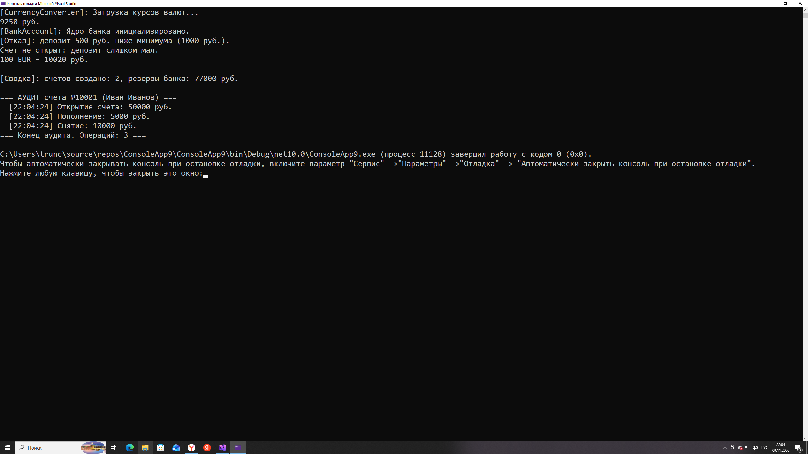

# Практическая Работа 13. Статические элементы, статические конструкторы, статические и вложенные классы в C#. Трунцев Богдан, П25-2.1


```csharp
using System;

namespace BankingHub
{
    // ============ ШАГ 1. Статический класс конвертера ============
    public static class CurrencyConverter
    {
        // Курсы живут в единственном экземпляре на всё приложение
        public static double UsdRate { get; private set; }
        public static double EurRate { get; private set; }

        // Статический конструктор: без модификаторов, без параметров,
        // вызывается CLR один раз при ПЕРВОМ обращении к классу
        static CurrencyConverter()
        {
            Console.WriteLine("[CurrencyConverter]: Загрузка курсов валют...");
            UsdRate = 92.5;
            EurRate = 100.2;
        }

        public static void UpdateRates(double newUsd, double newEur)
        {
            if (newUsd > 0) UsdRate = newUsd;
            if (newEur > 0) EurRate = newEur;
        }

        public static decimal ConvertToRub(decimal foreignAmount, string currencyCode)
        {
            switch (currencyCode)
            {
                case "USD": return (decimal)((double)foreignAmount * UsdRate);
                case "EUR": return (decimal)((double)foreignAmount * EurRate);
                // Некорректный код — возвращаем сумму без изменений
                default: return foreignAmount;
            }
        }
    }

    // ============ ШАГ 2–4. Класс счета со статикой и вложенными классами ============
    public class BankAccount
    {
        // ---- Статические элементы: принадлежат классу, а не объекту ----
        private static int _nextAccountNumber;                 // генератор номеров
        public static int TotalAccountsCreated { get; private set; }
        public static decimal GlobalBankReserves { get; private set; }

        // Статический конструктор — сработает один раз, перед первым
        // обращением к классу (в т.ч. раньше первого экземпляра)
        static BankAccount()
        {
            _nextAccountNumber = 10001;
            Console.WriteLine("[BankAccount]: Ядро банка инициализировано.");
        }

        // ---- Экземплярные элементы: у каждого счета свои ----
        public int AccountNumber { get; }
        public string OwnerName { get; }
        public decimal Balance { get; private set; }

        private StatementRecord[] _records = new StatementRecord[10];
        private int _recordCount = 0;

        // Закрытый конструктор: создать счет можно ТОЛЬКО через фабрику
        private BankAccount(string owner, decimal initialBalance)
        {
            AccountNumber = _nextAccountNumber++;   // уникальный номер
            OwnerName = owner;
            Balance = initialBalance;
            AddRecord("Открытие счета", initialBalance);
        }

        // Статический фабричный метод — контролирует правила открытия
        public static BankAccount OpenAccount(string owner, decimal initialDeposit)
        {
            if (initialDeposit < 1000m)
            {
                Console.WriteLine($"[Отказ]: депозит {initialDeposit} руб. ниже минимума (1000 руб.).");
                return null;
            }
            TotalAccountsCreated++;
            GlobalBankReserves += initialDeposit;
            return new BankAccount(owner, initialDeposit);
        }

        // ---- Бизнес-методы ----
        public void Deposit(decimal amount)
        {
            if (amount <= 0) return;
            Balance += amount;
            GlobalBankReserves += amount;
            AddRecord("Пополнение", amount);
        }

        public bool Withdraw(decimal amount)
        {
            if (amount <= 0 || amount > Balance) return false;
            Balance -= amount;
            GlobalBankReserves -= amount;
            AddRecord("Снятие", amount);
            return true;
        }

        // Закрытый метод ведения истории
        private void AddRecord(string op, decimal amount)
        {
            if (_recordCount < _records.Length)
                _records[_recordCount++] = new StatementRecord(op, amount);
        }

        // ============ ШАГ 3. Вложенные классы ============

        // Закрытый вложенный класс: снаружи недоступен вообще
        private class StatementRecord
        {
            public DateTime Timestamp { get; }
            public string OperationType { get; }
            public decimal Amount { get; }

            public StatementRecord(string operationType, decimal amount)
            {
                Timestamp = DateTime.Now;
                OperationType = operationType;
                Amount = amount;
            }
        }

        // Публичный вложенный класс: доступен как BankAccount.SecurityAudit,
        // и при этом видит private-члены BankAccount
        public class SecurityAudit
        {
            public static void Inspect(BankAccount account)
            {
                Console.WriteLine($"\n=== АУДИТ счета №{account.AccountNumber} ({account.OwnerName}) ===");
                for (int i = 0; i < account._recordCount; i++)
                {
                    StatementRecord r = account._records[i];
                    Console.WriteLine($"  [{r.Timestamp:HH:mm:ss}] {r.OperationType}: {r.Amount} руб.");
                    if (r.Amount > 50000m)
                        Console.WriteLine("  !!! ПРЕДУПРЕЖДЕНИЕ ФИНМОНИТОРИНГА: транзакция свыше 50 000 руб.");
                }
                Console.WriteLine($"=== Конец аудита. Операций: {account._recordCount} ===");
            }
        }
    }

    // ============ ШАГ 5. Демонстрация ============
    class Program
    {
        static void Main()
        {
            // 1) Первое обращение к конвертеру ДО создания счетов:
            //    здесь CLR запустит статический конструктор CurrencyConverter
            Console.WriteLine(CurrencyConverter.ConvertToRub(100, "USD") + " руб.");

            // 2) Отказ по минимальному депозиту — фабрика вернет null
            BankAccount rejected = BankAccount.OpenAccount("Тестовый", 500);
            if (rejected == null) Console.WriteLine("Счет не открыт: депозит слишком мал.");

            // 3) Открытие двух счетов: при ПЕРВОМ вызове сработает
            //    статический конструктор BankAccount (один раз!)
            BankAccount account1 = BankAccount.OpenAccount("Иван Иванов", 50000);
            BankAccount account2 = BankAccount.OpenAccount("Анна Смирнова", 20000);

            // 4) Транзакции
            account1.Deposit(5000);
            account1.Withdraw(10000);
            account2.Deposit(15000);
            account2.Withdraw(3000);
            Console.WriteLine($"100 EUR = {CurrencyConverter.ConvertToRub(100, "EUR")} руб.");

            // 5) Сводка через СТАТИЧЕСКИЕ свойства (обращение по имени класса)
            Console.WriteLine($"\n[Сводка]: счетов создано: {BankAccount.TotalAccountsCreated}, " +
                              $"резервы банка: {BankAccount.GlobalBankReserves} руб.");

            // 6) Аудит через публичный вложенный класс
            BankAccount.SecurityAudit.Inspect(account1);

            // 7) Демонстрация ошибки компиляции:
            // new BankAccount.StatementRecord("Пополнение", 100);
            // CS0122: 'BankAccount.StatementRecord' недоступен из-за его уровня защиты —
            //         private-класс невидим снаружи.
        }
    }
}
